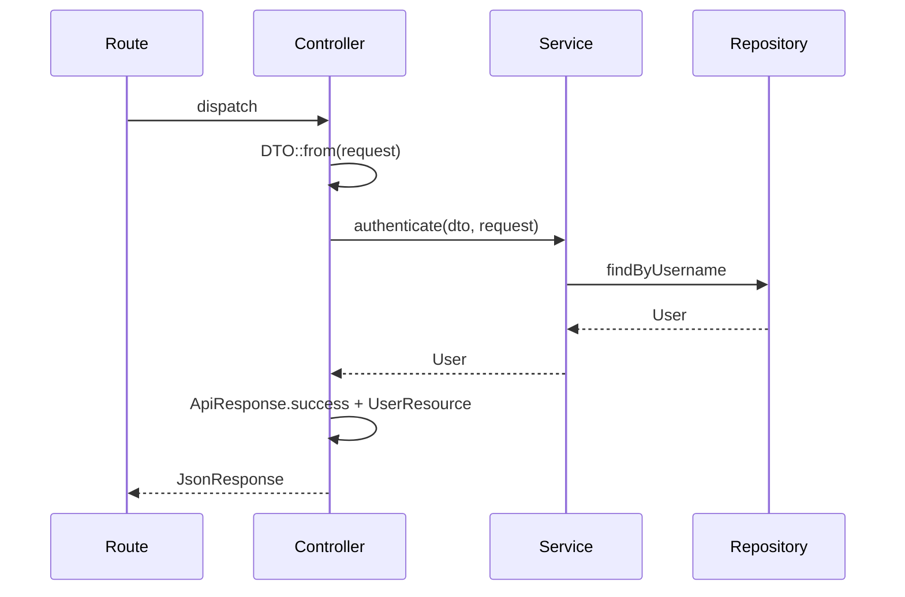

::: info Generated page
This page is generated from `.claude/rules/arcus-api-architecture.md` — **edit the source rule, not this page.** Activates for: `api.rnc/**`.
:::

# API Architecture Rules

This document describes the request flow, module structure (DDD-style), and conventions for factories and seeders. Follow these patterns when implementing new features.

## 1. Request flow pattern

Canonical flow for API endpoints (e.g. login):

```
ROUTE → REQUEST → CONTROLLER → DTO → SERVICE → REPOSITORY → ApiResponse with Resource
```



**Layer summary:**

- **Route** (`routes/api.php`): HTTP verb + path → `[Controller::class, 'method']`. Register routes here. An integer parameter is `{id}` (or another name listed in `AppServiceProvider::NUMERIC_ROUTE_PARAMETERS`), which only matches digits — so `ideas/options` is reached even when declared after `ideas/{id}`, and declaration order is never part of the contract (chapaja).

  ```php
  // routes/api.php
  Route::post('/login', [AuthController::class, 'login']);
  ```

- **Request**: FormRequest in `Modules/{Module}/Requests/`. Validation runs before the controller. Type-hint the request in the controller method. **Normalize an identifier in `prepareForValidation()`** (a phone number, an e-mail's case), not in the service — so the rules, the throttle key and the row that gets written all see exactly the same value (see `RegisterRequest`).

  ```php
  // Modules/Auth/Requests/LoginRequest.php
  public function rules(): array
  {
      return [
          'username' => ['required', 'string'],
          'password' => ['required', 'string'],
      ];
  }
  ```

- **Controller**: Keep thin. Build DTO from request, call service, return `ApiResponse::success(data: new XxxResource($model))` (or `ApiResponse::created`, `ApiResponse::error`, etc.). **For simple conditional returns** (e.g., null checks), prefer ternary operator syntax: `return !$value ? ApiResponse::notFound(message: '...') : ApiResponse::success(data: new XxxResource($value));`

  ```php
  // Modules/Auth/Controllers/AuthController.php
  public function login(LoginRequest $request): JsonResponse
  {
      $user = $this->authService->authenticate(LoginDTO::from($request), $request);

      return ApiResponse::success(data: new UserResource($user));
  }
  ```

- **DTO**: Spatie `Data` in `Modules/{Module}/DTOs/`. Use `XxxDTO::from($request)` to map validated input. Pass DTOs into services; pass `Request` only when needed (e.g. session).

  What makes that "validated" true is `config/data.php`: it enables `FormRequestNormalizer` ahead of
  `ArrayableNormalizer`, so a FormRequest is read with `validated()`. The package ships it disabled,
  and then `from($request)` is `$request->all()` — a field with no rule, or one an `exclude_*` rule
  removed, reaches the service (chapaja). Keep that order; `DtoValidatedInputTest` fails without it.

  ```php
  // Modules/Auth/DTOs/LoginDTO.php
  class LoginDTO extends Data
  {
      public function __construct(
          public string $username,
          public string $password,
      ) {}
  }
  ```

- **Service**: Business logic in `Modules/{Module}/Services/`. Uses repositories (and optionally `App\Models\*`). Returns model(s) or throws (e.g. `ValidationException`).

  ```php
  // Modules/Auth/Services/AuthService.php
  public function authenticate(LoginDTO $dto, Request $request): User
  {
      $user = $this->userRepository->findUserByUsername($dto->username);

      if (! $user || ! Hash::check($dto->password, $user->password)) {
          throw ValidationException::withMessages(['username' => __('auth.failed')]);
      }

      return $user;
  }
  ```

- **Repository**: Data access in `Modules/{Module}/Repositories/`. Injected into service. Uses Eloquent models (`App\Models\*` or module-specific `Modules/{Module}/Models/*`). **Method naming**: Use semantic, descriptive names prefixed with the entity name (e.g. `findAllRoles()`, `findRoleById()`, `createRole()`, `updateRole()`, `syncRolePermissions()`, `getRolePermissions()`). This improves code searchability and clarity compared to generic names like `findAll()`, `findById()`, `create()`, `update()`.

  ```php
  // Modules/Auth/Repositories/UserRepository.php
  public function findUserByUsername(string $username): ?User
  {
      return User::where('username', $username)->first();
  }
  ```

- **ApiResponse + Resource**: Controller wraps the model in `Modules/{Module}/Resources/XxxResource` and returns `ApiResponse::success(data: new XxxResource($model))`. Use `App\Helpers\ApiResponse` and Laravel `JsonResource` for consistent JSON.

  ```php
  // Modules/Auth/Resources/UserResource.php
  public function toArray(Request $request): array
  {
      return [
          'id' => $this->id,
          'name' => $this->name,
          'username' => $this->username,
      ];
  }
  ```

**Granular updates (frontend):** Mutating endpoints (create, update, archive, delete) should **return the affected resource** in the response so the frontend can update local state without refetching the full list. For example: `destroy($id)` should return the deleted user (e.g. build `UserResource` from the model before or after delete and return it in `ApiResponse::success(data: ...)`). Same for archive/update: return the updated entity. This enables granular updates (add/replace/remove one item in a ref) instead of full reloads.

**Deleting a row something still references (CRITICAL).** A foreign key that protects the row
(`restrictOnDelete`) makes the database refuse the delete, and an uncaught `QueryException` is a
500 for what is really a rule: "this is in use". Catch it in the service and rethrow as a 422 that
names the rule with an i18n key. Catch the CONSTRAINT rather than asking the other module who points
at the row — the dependency stays one-way, and a new referencing table is covered without an edit.

```php
// Modules/Catalog/Services/CategoryService.php
private const INTEGRITY_CONSTRAINT_VIOLATION = '23000';

public function delete(int $id): bool
{
    try {
        return $this->categoryRepository->deleteCategory($id);
    } catch (QueryException $exception) {
        if ($exception->getCode() !== self::INTEGRITY_CONSTRAINT_VIOLATION) {
            throw $exception;
        }

        throw ValidationException::withMessages(['id' => ['catalog.category.inUse']]);
    }
}
```

**A concurrent create loses to a unique index — catch it and read the winner.** Two requests that
both saw "no row" race to insert, and the loser hits the unique constraint as a 500. Catch the
`QueryException` for that constraint and read the existing row back; the index is what makes the
answer correct, the catch is what makes it polite.

### Rows a person owns

- **Somebody else's id answers 404, never 403.** Every lookup is scoped by the owner as well as by
  the id, and the service returns null for the controller to answer "not found". A 403 confirms the
  row exists. The same holds for a token or a code in a public link: every failure — wrong token,
  unknown code, no session — is the same calm "not found".
- **An id that arrives in the request is checked against its owner, not only for existence.**
  `Rule::exists('tags', 'id')` accepts anyone's tag. Ask whose it is, and for a child row, which
  parent it belongs to:

  ```php
  'tag_id' => [Rule::exists('tags', 'id')->where('user_id', $this->user()?->id)],
  'step_id' => [Rule::exists('steps', 'id')->where('category_id', $quote->category_id)],
  ```

  An `exists` that does not ask is how an id from another account — or another parent — gets written.
- **A child row does not carry a second owner column.** An entry belongs to its journal, and the
  journal to the person; a `user_id` copied onto the entry is a second answer to "whose is this" that
  can disagree with the first, and every write has to keep the two in step. Scope the child through
  its parent (`whereHas('journal', fn ($query) => $query->where('user_id', $userId))`) — lifeshifter.

### A domain failure the SPA has to branch on carries a code

A refusal the interface must react to differently — retry, resend, go somewhere else — cannot be
told apart by its sentence: the sentence is an i18n key today and prose tomorrow, and a front-end
that switches on it breaks when someone rewords it. Give the exception a **stable code** and let it
render itself:

```php
class VerificationException extends RuntimeException
{
    public const CODE_EXPIRED = 'code_expired';

    public function __construct(string $message, public readonly string $errorCode, public readonly int $status = 422)
    {
        parent::__construct($message);
    }

    public static function expired(): self
    {
        return new self('auth.verification.expired', self::CODE_EXPIRED);
    }

    public function render(): JsonResponse
    {
        return ApiResponse::error(message: $this->getMessage(), extraData: ['code' => $this->errorCode], status: $this->status);
    }
}
```

Laravel calls `render()` itself, so the service throws and the controller stays thin — no try/catch
to keep the "thin controller" rule. The message is still an i18n key; the code is what the SPA
reads. A rule the interface only reports (a 422 it shows inline) needs no code — this is for the
ones it has to ACT on.

### A resource is closed by default

A `JsonResource` that can carry something sensitive (an access token, a signed URL) is built without
it, and a method turns it on where it belongs: `(new ReservationResource($row))->withAccessToken()` in
the one response that creates it. A new call site then gets the closed shape without thinking about it.

### A permission that depends on the body

When a permission is needed only for some payloads (`refund: true` asks for `reservations.refund`), it
cannot sit on the route — check it in the controller, next to the input that asks for it. If the
secondary effect can fail on its own (the refund), report its outcome as a field of the response
instead of failing the main action.

### A rule across two fields on a partial update

A `PATCH` that sends one bound of a range still has to agree with the bound it did not send, and only
the service knows the stored value: merge what arrived over what is saved, then validate. Remove what
the request never sent before merging — an absent field and an explicit `null` are different things,
and the `null` (clear the notes) must survive.

### Ids are integers on the wire

Every resource emits `id` and every foreign id (`ideaId`, `mergedIntoId`) as an integer — never
`(string) $this->id`. The API once sent strings from some modules and numbers from others, and the
SPA carried both shapes (lifeshifter). A column Eloquent does not cast is cast in the resource:
`(int) $this->idea_id`. The SPA converts a route param or a query value once, where it reads it
(`toRouteId` in `@Helpers`), and compares numbers from then on.

### A route without auth answers through a `Public*` resource

An unauthenticated route never returns the admin resource. It answers through a
`Public{Entity}Resource` whose `toArray()` is an explicit allow-list: a field added to the admin
resource later must not appear on a public page because the two share a class (largatudoevai). The
landing template (`public.battoni.dev`) reads the API at BUILD time, so whatever a public endpoint
sends ends up baked into static HTML — and a leaked field stays leaked until the next deploy.

### A `<select>` is fed by `/options`, never by a paginated index

An index is paginated, so a `<select>` filled from it is silently cut at the page ceiling: the 101st
category exists and cannot be chosen, and nothing says so (chapaja, three times). A reference list
gets its own endpoint — `GET /{resource}/options` → `[{value, label}]`, active rows only, unpaginated,
ordered by label. A set too large to send whole gets server-side search instead. The current
workaround to replace when it is touched: `UsersView.view.vue` fetches one page of
`SEARCH_OPTIONS_PAGE_SIZE` for its search.

```php
// Modules/Catalog/Controllers/CategoryController.php
public function options(): JsonResponse
{
    return ApiResponse::success(data: $this->categoryService->options()); // [['value' => 3, 'label' => 'Bolos'], …]
}
```

### A status with rules is a transition graph on its enum

When a status cannot move freely, the graph lives on the enum — `allowedTransitions()`,
`canTransitionTo(self $next)`, `isTerminal()` — and the service asks it before writing. A refused
move is a 422 that names the rule with an i18n key, never a silent no-op and never a 500 (chapaja).
The graph in one place is what keeps the controller, the service and a scheduled job from each
growing their own copy.

```php
enum QuoteStatus: string
{
    case Draft = 'draft';
    case Sent = 'sent';
    case Accepted = 'accepted';
    case Cancelled = 'cancelled';

    /** @return list<self> */
    public function allowedTransitions(): array
    {
        return match ($this) {
            self::Draft => [self::Sent, self::Cancelled],
            self::Sent => [self::Accepted, self::Cancelled],
            self::Accepted, self::Cancelled => [],
        };
    }

    public function canTransitionTo(self $next): bool
    {
        return in_array($next, $this->allowedTransitions(), true);
    }

    public function isTerminal(): bool
    {
        return $this->allowedTransitions() === [];
    }
}
```

### What was agreed is copied onto the row

A price, a fee, a deadline — anything the person agreed to — is written onto the row at the moment of
commitment (`unit_price_cents`, `fee_percent`) and read from there forever after. Re-reading it from
settings or from the catalog later rewrites a past agreement the day someone edits the setting
(chapaja). The snapshot column is not duplication: it is the record of what was promised.

**Reference:** Login flow in `AuthController::login`, `AuthService::authenticate`, `UserRepository::findUserByUsername`, `UserResource` (all under `app/Modules/Auth/`).

### Repository method naming

**Use semantic, descriptive method names prefixed with the entity name.** This improves code searchability and clarity compared to generic names.

**Examples:**

- `findAllRoles()` instead of `findAll()`
- `findRoleById(int $id)` instead of `findById(int $id)`
- `createRole(array $data)` instead of `create(array $data)`
- `updateRole(int $id, array $data)` instead of `update(int $id, array $data)`
- `syncRolePermissions(int $roleId, array $permissions)` instead of `syncPermissions(int $roleId, array $permissions)`
- `getRolePermissions(int $roleId)` instead of `getPermissionsForRole(int $roleId)`

**Pattern:** `{action}{Entity}(...)` where action is descriptive (findAll, find, create, update, sync, get, delete, etc.) and Entity is the model name (Role, User, etc.).

**Reference:** `RoleRepository` methods in `app/Modules/Auth/Repositories/RoleRepository.php`.

---

## 2. DDD-style module structure

**Shared (app-wide):**

| Path | Purpose |
|------|---------|
| `app/Models/` | Eloquent models used across modules (e.g. `User`). |
| `app/Enums/` | Shared enums (e.g. `StatusEnum`). |
| `app/Helpers/` | Helpers (e.g. `ApiResponse`). |
| `app/Http/Controllers/Controller.php` | Base controller. |
| `app/Providers/` | Service providers. |

**Modules (bounded contexts):** `app/Modules/{Module}/`

| Folder | Purpose |
|--------|---------|
| `Controllers/` | HTTP entry points; thin, delegate to services. |
| `Requests/` | FormRequest validation. |
| `DTOs/` | Spatie Data DTOs; map from Request. |
| `Services/` | Domain/business logic; use Repositories. |
| `Repositories/` | Data access; use Models. |
| `Resources/` | API output (JsonResource). |
| `Models/` | Optional; module-specific Eloquent models. |
| `Enums/` | Optional; module-specific enums. |
| `Helpers/` | Optional; module-specific helpers (e.g. permission resolvers). |

**Rule:** New features follow this structure. Reuse existing modules when the feature belongs to that bounded context; create a new module only when it represents a new context. Match existing conventions (e.g. Auth) for naming and layering.

**A module reads another module's tables and never writes them.** A write belongs to the module that
owns the table, through its service — that is where its rules, its events and its audit live, and a
foreign `insert` skips all three (lifeshifter). A read is allowed, and it is **declared**: the reading
module's `RULES.md` lists every table it reads from another module, so a change to that table has a
list of who to tell.

---

## 3. Migrations — edit the create, never write an ALTER (CRITICAL)

**The bootstrap keeps no data.** There is nothing to preserve, so a table's `create_*`
migration is the ONLY description of that table, and it is edited until it is right.

- **Do not write `add_*_to_*_table`**, and do not write a migration that alters, renames or
  drops a column or a table. A new column goes into the `create_*` migration, in the
  position it belongs, as if it had always been there.
- **The database is rebuilt, not patched**: `make fresh` (`migrate:fresh --seed`). The
  seeders are the source of the reference rows.
- **Ordering is part of the edit.** A folded foreign key needs its target table created
  first, which sometimes means renaming a `create_*` file to an earlier timestamp. Do that
  rather than reaching for an ALTER.
- **Data migrations that backfill existing rows are deleted, not kept.** On a fresh database
  they are no-ops, and a no-op that reads like a step is worse than no step. Whatever they
  backfilled belongs in a seeder.
- **Verify by rebuilding, and compare.** Dump the schema before folding, run `make fresh`, dump it again and diff the two. Identical, or the fold is not done — "the tests pass" does not show a column that moved or a default that changed.

**A module arriving by back-port is where this rule gets tested.** The project it came from
may have shipped and may reason about production data, cheap ALTERs and columns added after
the fact. **That premise does not travel.** Fold its ALTERs into the creates, drop its
backfills, and rewrite any prose that argues from a launch date the bootstrap does not have.

---

## 4. Factories

**Location:** `database/factories/`.

**Conventions:**

- One factory per model, named `XxxFactory`, extending `Illuminate\Database\Eloquent\Factories\Factory`.
- Implement `definition()` returning the default attribute array; use `fake()` and relevant enums (e.g. `UserFactory` enum).
- Model uses `HasFactory` and `@use HasFactory<\Database\Factories\XxxFactory>`.
- Factories may use shared or module enums; keep them in `database/factories/`.

**Rule:** Use factories for tests and local dev data. Do not put business logic in factories.

**Reference:** `database/factories/UserFactory.php`, `app/Models/User.php` (HasFactory).

---

## 5. Seeders

**Location:** `database/seeders/`.

**Conventions:**

- **DatabaseSeeder**: Orchestrator. Uses `WithoutModelEvents`. Calls domain seeders via `$this->call(XxxSeeder::class)`.
- **Domain seeders** (e.g. `SuperAdminSeeder`): Seed specific data. Use Models, enums, `firstOrCreate` / `create` as appropriate. Read secrets through config (`config('seeding.superadmin_password')`), never `env()`: under a cached config `env()` is null and the guessable default ships. (This line used to say "use `env()` with a safe default"; `database/RULES.md` and larastan both refuse that.)
- **Rule:** Seeders are for initial or reference data. Prefer seeders over one-off scripts when the data is part of app setup. Do not duplicate logic that belongs in the Service/Repository layer.

**Reference:** `database/seeders/DatabaseSeeder.php`, `database/seeders/SuperAdminSeeder.php`.

---

## 6. Code hygiene

General PHP hygiene expected in every api.rnc file, on top of the request-flow and layering rules above.

**No abbreviations.** Use full, semantic names. `$repository`, `$user`, `$request`, `$index` — never `$repo`, `$u`, `$req`, `$idx`. Mirrors the app.rnc no-abbreviations rule.

**Blank line after an early return.** A guard clause is followed by a blank line before the next statement — the guard and the main body read as distinct blocks.

```php
if (! $user) {
    throw ValidationException::withMessages(['username' => __('auth.failed')]);
}

return $user;
```

**No inline fully-qualified names.** Never reference a class by an inline `\Fully\Qualified\Name` in the body — add a `use` at the top and reference the short name. Keeps call sites readable and imports auditable.

```php
// ❌ NEVER
return \App\Helpers\ApiResponse::success(data: $resource);

// ✅ ALWAYS — `use App\Helpers\ApiResponse;` at top
return ApiResponse::success(data: $resource);
```

**Extract magic values to a named constant or backed Enum.** Meaningful string/number/array literals become a named `UPPER_SNAKE` class constant (or a backed `Enum` when it is a fixed set) — never a bare literal mid-logic.

```php
// ❌ NEVER
if (in_array($user->status, ['active', 'pending'])) { ... }

// ✅ ALWAYS
private const ASSIGNABLE_STATUSES = ['active', 'pending'];

if (in_array($user->status, self::ASSIGNABLE_STATUSES)) { ... }
```
